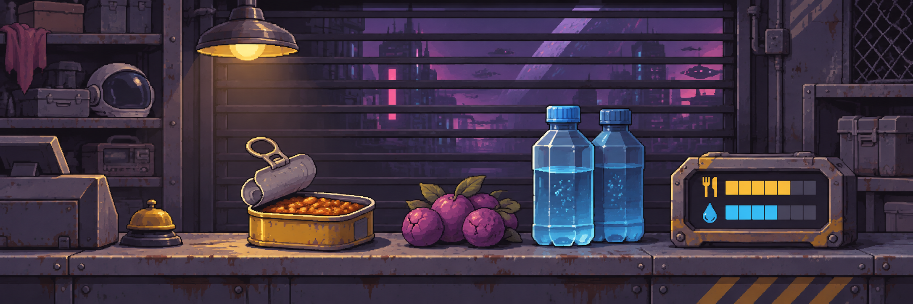
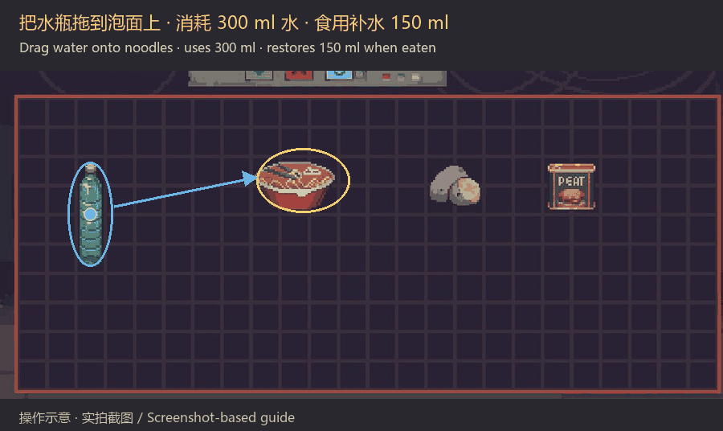
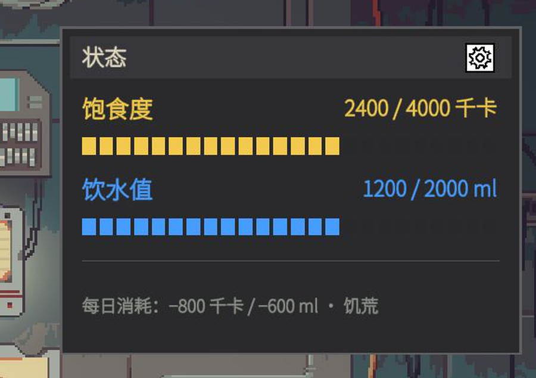
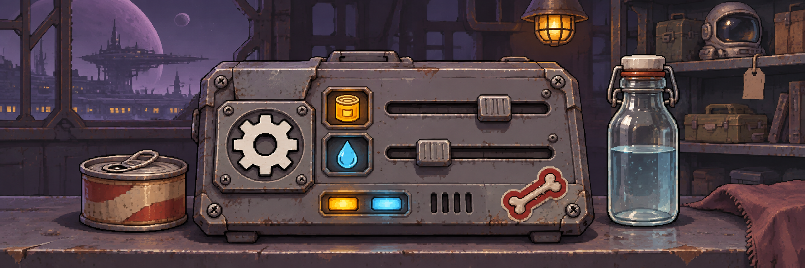
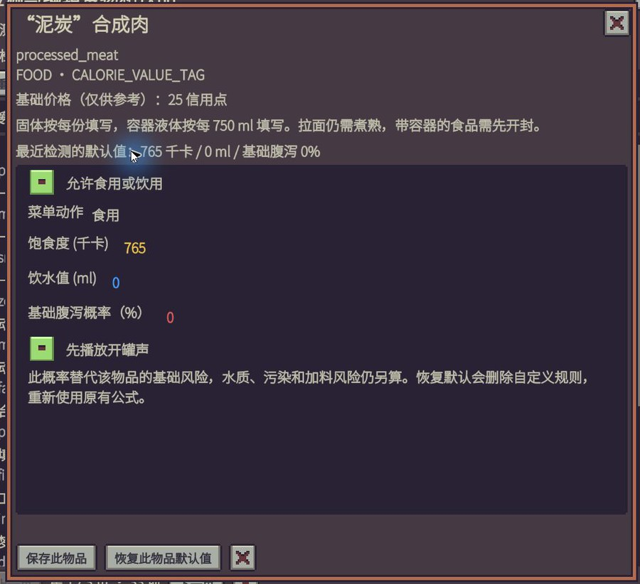
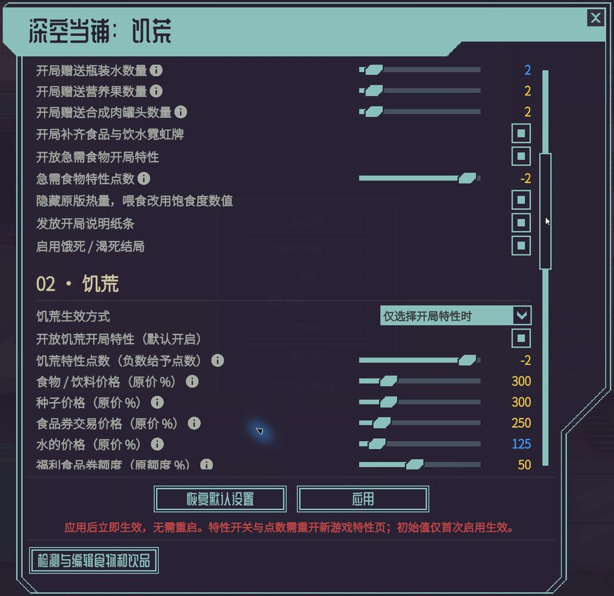

# Probably Starve
## 深空当铺：饥荒

房租还没攒够，肚子又饿了。这个 Mod 加入饱食度和饮水值，让你在经营当铺、攒钱交租之余，也得想想下一顿吃什么。喝水、开罐头、咀嚼都有音效，忙不过来还能打电话叫份外卖。

泡面、吸面和汽水开罐也加上了音效，推荐开着声音玩。

**想多一点挑战？新开局可以选择“饥荒”负面特性。饥荒挑战默认关闭**，需要时再选，也可以在设置里全局启用。

**觉得太难？** 可以在设置里调低每天的饱食度和水分消耗。

### 泡一碗面

把装有水的水瓶拖到未煮的泡面上，消耗 **300 ml 水**，就能做成熟面。吃完补充饱食度和 **150 ml 水分**。

### 怎么看状态

**鼠标移到床铺上**，就能看到食水储备：黄色是饱食度，蓝色是饮水值。外出或在交通地图时，**悬停右下角食水图标**展开状态栏。面板上的齿轮可以打开设置；主菜单 **Mods（改装件）→ 本 Mod 齿轮** 也能进入。

两条状态条中间的细竖线是 **50%**。新开局默认满食水；每天首次开店时，两项都高于 50% 就有 **70% 概率多来一位顾客**。到达垃圾场时也满足门槛，当天还能多挖一次。奖励门槛、概率和次数都能在设置里调整。

新开局会收到一张说明纸条，不需要可以在设置里取消。食水会扣到负数；已经饿着或渴着时睡觉会提醒，强行睡觉会进入饿死或渴死结局。

### 每种食物都能自己调

设置最下面有 **“检测与编辑食物和饮品”**。进入存档后检测当前游戏和已启用 Mod 的食物、饮品，再按名称或 ID 找到想改的物品。

你可以决定它能不能吃、菜单显示“食用”还是“饮用”、补多少饱食度和水、基础腹泻概率，以及是否先播放开罐声。点“保存此物品”立即生效，所有存档共用；也能单独恢复默认。

### 还有哪些能设置

- **每天吃多少、喝多少**：初始储备、上限、每日消耗都能改，也能按接待顾客的人数增加消耗，或取消饿死、渴死结局。
- **吃腻**：不想一直靠最便宜的食物过日子，可以让连续几天吃廉价食物后，有机会少补一些饱食度。多少钱算便宜、连吃几天、概率和少补多少都能定。
- **腹泻**：风险食水可能让你第二天闹肚子。病中继续喝风险饮品会加重，正常的水不会。它增加每天的消耗，尤其是水；患病概率、额外消耗、多久恢复都能改。
- **饥荒和外卖**：食物、种子和水涨多少价，饥荒特性给几点，都由你定。外卖随市场价：单品加20%、套餐加10%；急送分别加100%和80%，均可调。套餐有5个营养果、3罐肉或3瓶水。
- **操作与界面**：双击吃喝默认关闭，习惯这样操作可以打开；面板大小和吃喝音效也可以调整。

### 开局先备点吃喝

默认送 **2 瓶水、2 个营养果、2 罐合成肉**，以及食品霓虹牌和饮水霓虹牌。

新增 **“急需食物” −2 特性**，选择后不会获得开局食物。

支持中文、英文等 11 种语言，跟随游戏语言。等游戏更新“小吃”职业后，这个 Mod 也会同步更新适配。

喜欢这个 Mod 的话，欢迎给个 **5⭐** 支持一下！也欢迎大家分享新玩法、聊聊平衡，或留下问题和建议。

---

## English

You’re still saving for rent, and your stomach is growling again. This mod adds hunger and thirst, so keeping the shop running also means finding your next meal. Includes drinking, can-opening and chewing sounds, plus takeaway by phone when you’re busy.

Noodle preparation, slurping and opening soda cans have their own sounds too. Try playing with sound on.

**Famine is off by default.** Choose the negative starting perk for a new run, or enable it globally in settings.

**Too difficult?** Lower daily food and water consumption in settings.

### Make some noodles

Drag a water bottle onto uncooked noodles. **300 ml of water** makes a meal that restores satiety and **150 ml of hydration**.

### Check your reserves

**Hover over the bed** to see your status: yellow for satiety, blue for hydration. Outside or on the transit map, **hover over the food-and-water icon at the bottom right**. Open settings with the status gear, or through **Main menu → Mods → this mod’s gear**.

The thin marks on both bars show **50%**. New runs start with full reserves. At the first opening each day, both above 50% give a **70% chance of one extra customer**. Arrive at the Dumping Grounds above the same threshold for one extra search that day. Adjust the threshold, chance and search count in settings.

New runs get an optional guide note. Reserves can go below zero; forcing sleep after the warning leads to starvation or dehydration.

### Edit individual foods and drinks

Open **“Detect and edit food and drinks”** at the bottom of settings. Load a save to scan game and mod items, then search by name or ID.

Set each item’s edibility, Eat/Drink action, satiety, hydration, base diarrhea chance and can-opening sound. Changes apply across all saves. Each item can be reset separately.

### Set your own difficulty

- **Daily needs:** Starting reserves, limits, daily and per-customer consumption, and survival endings.
- **Food fatigue:** Repeated cheap meals may become less filling. Set what counts as cheap, how many consecutive days, the chance and the reduction.
- **Illness:** Risky food and water can cause diarrhea the next morning. Risky drinks worsen it; clean water does not. Set the chances, daily losses and recovery time.
- **Famine and takeaway:** Prices and perk points; market-based takeaway adds 20% for singles or 10% for packs, express 100% or 80%. Packs: 5 fruit, 3 meat tins or 3 waters. All adjustable.
- **Controls and UI:** Double-click consumption is off by default. Panel size and consumption sounds are adjustable.

### Starting supplies

Start with **2 water bottles, 2 Nutrifruit and 2 synthetic meat tins**, plus food and water neon signs.

Choose the new **Food Needed perk (−2)** to start without the food supplies.

Supports 11 languages and follows the game’s language. This mod will be updated to support the snack vendor profession when it arrives.

If you’re enjoying the mod, a **5⭐ rating** would mean a lot. New gameplay ideas, balance feedback and bug reports are always welcome.
